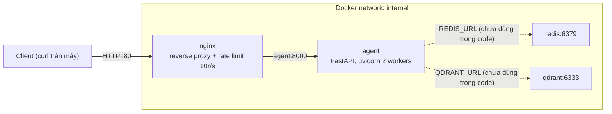

# Day 14 Lab - Mission Answers

## Part 1: Localhost vs Production

### Exercise 1.1: Anti-patterns found
### Exercise 1.1
1. Dòng 17–18 — Hardcode thông tin nhạy cảm (`OPENAI_API_KEY` và `DATABASE_URL` chứa mật khẩu) trực tiếp trong mã nguồn. Khi push lên GitHub, ai cũng có thể đọc được; kẻ xấu sẽ đánh cắp API key để gọi dịch vụ tính tiền vào tài khoản của mình hoặc truy cập trái phép vào cơ sở dữ liệu[cite: 1].
2. Dòng 21–22 — Cấu hình viết cứng (`DEBUG = True`, `MAX_TOKENS = 500`) thay vì đọc từ biến môi trường. Khi muốn thay đổi cấu hình giữa môi trường dev và production, lập trình viên buộc phải sửa trực tiếp mã nguồn và deploy lại; đồng thời nếu sau này code mở rộng và dùng tới biến `DEBUG`, ứng dụng trên production sẽ mặc định chạy ở chế độ debug[cite: 1].
3. Dòng 33–38 — Dùng `print()` thay cho thư viện logging chuẩn, đặc biệt tại **dòng 34** lại in thẳng `OPENAI_API_KEY` ra màn hình console (và **dòng 38** in toàn bộ `response` ra log)[cite: 1]. Trên server thật, log thường được lưu tập trung hoặc gửi ra hệ thống giám sát; việc in secret và nội dung phản hồi vào log làm lộ API key cũng như dữ liệu nhạy cảm của người dùng cho bất kỳ ai có quyền đọc log, đồng thời `print()` thiếu cấp độ log (INFO, ERROR) và timestamp để truy vết sự cố.
4. Dòng 42–43 — Thiếu endpoint kiểm tra sức khỏe hệ thống (như `/health` hoặc `/healthz`)[cite: 1]. Khi chạy trên các nền tảng cloud/container (như Kubernetes, Render, Railway), hệ thống không có tín hiệu để biết ứng dụng đang hoạt động bình thường hay đã treo/crash để tự động khởi động lại (auto-restart) hoặc điều hướng traffic sang instance khác.
5. Dòng 49–53 — Cấu hình server chạy cứng cho môi trường local thay vì đọc từ biến môi trường[cite: 1]:
   - `host="localhost"` (dòng 51): Chỉ lắng nghe kết nối nội bộ từ chính máy chủ đó, khiến người dùng bên ngoài hoặc reverse proxy của cloud platform không thể truy cập được ứng dụng[cite: 1].
   - `port=8000` (dòng 52): Không đọc biến `PORT` do các nền tảng như Railway/Render tự động cấp phát, dẫn đến lỗi không bind được cổng và deploy thất bại[cite: 1].
   - `reload=True` (dòng 53): Chạy thêm một tiến trình giám sát thay đổi của file gây tốn tài nguyên hệ thống, và mỗi khi có file thay đổi, server tự khởi động lại làm rơi toàn bộ các request đang xử lý dở[cite: 1].
6. Dòng 47–53 — Khối khởi chạy server không có cơ chế tắt an toàn (graceful shutdown) và không xử lý tín hiệu dừng từ hệ điều hành (`SIGTERM`)[cite: 1]. Khi cloud platform dừng container hoặc deploy phiên bản mới, ứng dụng bị ngắt đột ngột khiến các request đang xử lý dở bị cắt ngang và có thể gây mất mát hoặc sai lệch dữ liệu.

### Exercise 1.2: Kết quả chạy bản develop
Lệnh gọi (terminal B):

```
$ curl -i -X POST "http://localhost:8000/ask?question=Hello"
HTTP/1.1 200 OK
date: Wed, 25 Nov 2026 07:50:45 GMT
server: uvicorn
content-length: 103
content-type: application/json

{"answer":"Tôi là AI agent được deploy lên cloud. Câu hỏi của bạn đã được nhận."}
```

Log server (terminal A):

```
INFO:     Uvicorn running on http://localhost:8000 (Press CTRL+C to quit)
INFO:     Started reloader process [1997] using WatchFiles
INFO:     Started server process [1999]
[DEBUG] Got question: Hello
[DEBUG] Using key: sk-hardcoded-fake-key-never-do-this
[DEBUG] Response: Tôi là AI agent được deploy lên cloud. Câu hỏi của bạn đã được nhận.
INFO:     127.0.0.1:33622 - "POST /ask?question=Hello HTTP/1.1" 200 OK
```

**Nhận xét:** App chạy được và trả về 200, nhưng chưa sẵn sàng cho production: API key bị in thẳng ra log (dòng `Using key`), câu hỏi và câu trả lời của người dùng cũng bị ghi nguyên văn, và `reload=True` sinh thêm một tiến trình reloader [1997] chạy song song với server [1999].
### Exercise 1.3: Comparison table
### Exercise 1.3: Comparison table

| Feature | Develop | Production | Tại sao quan trọng? |
| :--- | :--- | :--- | :--- |
| Config | Viết cứng (`app.py` dòng 17–22) | Đọc từ biến môi trường (`config.py` dòng 17–32) | Dùng chung một bộ mã nguồn cho cả dev, staging và prod mà không cần sửa code khi đổi môi trường, chỉ cần thay đổi biến cấu hình tương ứng (như database, giới hạn token hay mức log). |
| Secrets | Key nằm trong code và bị in ra log (dòng 17, 34) | `os.getenv("OPENAI_API_KEY")`, không log secret (`app.py` dòng 110–115) | Tránh lộ API key hay mật khẩu khi đẩy code lên GitHub hoặc khi log được đẩy sang hệ thống giám sát tập trung, ngăn kẻ xấu đánh cắp tài nguyên và phát sinh chi phí ngoài ý muốn. |
| Host / Port | `localhost`, `8000` cứng (dòng 51–52) | `0.0.0.0`, đọc `PORT` từ env (`app.py` dòng 196–197) | `0.0.0.0` cho phép nhận kết nối từ bên ngoài container/server thay vì chỉ nội bộ máy chủ, còn đọc `PORT` từ biến môi trường giúp tương thích với cổng cấp phát động của các nền tảng cloud như Render hay Railway. |
| Health check | Không có (`/health` trả 404) | `/health` (liveness) và `/ready` (readiness), dòng 135–161 | Cloud platform và load balancer định kỳ gọi các endpoint này: `/health` kiểm tra app còn sống hay đã treo để tự động restart nếu không trả về 200, còn `/ready` xác nhận app đã nạp xong dữ liệu/kết nối và sẵn sàng nhận traffic từ người dùng. |
| Logging | `print()` cả nội dung câu hỏi/trả lời (dòng 33–38) | Log JSON, chỉ ghi độ dài (dòng 28–31, 110–122) | Log định dạng JSON có cấu trúc giúp các công cụ phân tích dễ dàng lọc và truy vết sự cố, trong khi việc chỉ ghi độ dài thay vì nội dung gốc giúp bảo vệ dữ liệu riêng tư của người dùng (PII). |
| Shutdown | Tắt đột ngột, không xử lý | `lifespan` + bắt `SIGTERM` (dòng 63–67, 180–189) | Khi deploy bản mới hoặc dừng container, hệ thống gửi tín hiệu `SIGTERM` để app ngừng nhận request mới nhưng vẫn hoàn tất nốt các request đang xử lý dở thay vì cắt ngang gây lỗi cho người dùng. |
| Reload | `reload=True` luôn bật, có tiến trình reloader | Chỉ bật khi `DEBUG=true` (dòng 198), chỉ 1 tiến trình | Tắt reload trên production giúp tiết kiệm CPU/RAM do không phải chạy thêm tiến trình theo dõi thay đổi file, đồng thời tránh việc server tự khởi động lại bất ngờ làm rớt các kết nối đang chạy. |

**Quan sát thực tế khi chạy `production/app.py`:**
Về mặt thiết kế, bản production cấu hình log dạng JSON và ẩn thông tin nhạy cảm/nội dung câu hỏi. Tuy nhiên khi chạy thử nghiệm thực tế, log terminal chỉ xuất hiện các dòng truy cập mặc định của Uvicorn (`INFO: 127.0.0.1:... "POST /ask HTTP/1.1" 200 OK`) mà không có dòng log JSON nào của ứng dụng (như `"event": "startup"` hay `"event": "agent_request"`): nguyên nhân là do `config.py` gọi `logging.warning()` trước khi `app.py` thiết lập `basicConfig`, khiến Python tự khởi tạo logger gốc ở mức `WARNING` với định dạng mặc định (`WARNING:root:...`) và bỏ qua cấu hình định dạng JSON ở mức `INFO` phía sau[cite: 2, 3].
## Part 2: Docker
## Part 2: Docker

### Exercise 2.1

1. **Base image là gì?**
   * **Base image:** `python:3.11` (dòng 8: `FROM python:3.11`).
   * **Kích thước:** Theo ghi chú ngay phía trên dòng `FROM` (dòng 7), đây là bản phân phối Python đầy đủ (full Python distribution) có dung lượng khoảng **~1 GB** (đi kèm nhiều công cụ hệ điều hành và thư viện biên dịch không thực sự cần thiết khi chạy production, dùng để làm mốc đối chiếu khi tối ưu dung lượng sang multi-stage build ở Exercise 2.3).

2. **Working directory là gì?**
   * **Working directory:** `/app` (dòng 11: `WORKDIR /app`).
   * Toàn bộ các lệnh tiếp theo như `COPY` (dấu `.` đại diện cho `/app`), `RUN` hay `CMD` đều lấy thư mục `/app` bên trong container làm gốc thực thi.

3. **Vì sao `COPY requirements.txt` đứng trước `COPY app.py`?**
   * **Cơ chế Layer Cache của Docker:** Docker build image theo từng lớp (layer) tuần tự từ trên xuống dưới, mỗi lệnh (`FROM`, `COPY`, `RUN`...) tạo ra một layer. Trước khi chạy một bước, Docker kiểm tra xem tệp đầu vào hoặc câu lệnh tại bước đó có thay đổi so với lần build trước không. Nếu không đổi, Docker tái sử dụng ngay kết quả đã lưu trong cache; nhưng **một khi một layer bị thay đổi, toàn bộ các layer nằm bên dưới nó đều bị vô hiệu hóa cache (cache invalidation) và buộc phải chạy lại từ đầu**.
   * **Tối ưu hóa quá trình build:**
     * **Khi tách riêng và đặt `COPY requirements.txt` trước:** Mã nguồn (`app.py`) là thứ lập trình viên sửa liên tục, trong khi danh sách thư viện (`requirements.txt`) rất ít khi thay đổi. Khi bạn chỉ sửa 1 dòng trong `app.py` rồi chạy `docker build` lại, Docker thấy `requirements.txt` không đổi nên lấy ngay kết quả từ cache cho cả bước `COPY requirements.txt` lẫn bước `RUN pip install -r requirements.txt` (vốn tốn hàng chục giây hoặc vài phút tải và cài gói), chỉ chạy lại từ bước `COPY app.py` trở đi nên build xong chỉ trong vài giây.
     * **Nếu copy toàn bộ code trước (ví dụ `COPY . .` trước `pip install`):** Chỉ cần sửa một dấu phẩy trong `app.py` cũng làm thay đổi dữ liệu đầu vào của lớp `COPY`, kéo theo lớp `RUN pip install` bên dưới mất cache và phải tải, cài lại toàn bộ thư viện từ đầu ở mọi lần build.
   * **Liên hệ với database:** Cơ chế này hoạt động tương tự cơ chế query cache hoặc materialized view trong SQL — khi bảng dữ liệu đầu vào của một truy vấn nặng không thay đổi, hệ thống trả về luôn kết quả đã tính sẵn thay vì quét và tính toán lại toàn bộ dữ liệu.

4. **`CMD` khác `ENTRYPOINT` thế nào?**
   * **`ENTRYPOINT`** quy định tiến trình chính cố định mà container sẽ luôn thực thi khi khởi động (giống phần **đường dẫn chương trình gốc** trong một shortcut trên Windows, ví dụ `python`). Nếu muốn đổi `ENTRYPOINT` lúc chạy, người dùng phải truyền cờ tường minh `--entrypoint`.
   * **`CMD`** đóng vai trò cung cấp lệnh mặc định hoặc bộ tham số mặc định truyền vào cho `ENTRYPOINT` (giống phần **tham số mặc định** đằng sau tên chương trình trong shortcut). `CMD` rất linh hoạt: nếu bạn chạy `docker run agent-develop`, container sẽ chạy lệnh mặc định `python app.py` (dòng 26); nhưng nếu bạn truyền thêm lệnh ở cuối như `docker run agent-develop bash` hoặc `docker run agent-develop python test.py`, toàn bộ phần `CMD` mặc định sẽ bị ghi đè bởi lệnh mới đó[cite: 4].
### Exercise 2.2: Build và run

Lệnh (chạy từ gốc repo):

```
docker build -f 02-docker/develop/Dockerfile -t my-agent:develop .
docker run --rm -p 8000:8000 my-agent:develop
```

Kết quả gọi container:

```
$ curl -i http://localhost:8000/health
HTTP/1.1 200 OK
server: uvicorn
content-type: application/json

{"status":"ok","uptime_seconds":12.7,"container":true}

$ curl -i -X POST "http://localhost:8000/ask?question=What%20is%20Docker"
HTTP/1.1 200 OK
server: uvicorn
content-type: application/json

{"answer":"Container là cách đóng gói app để chạy ở mọi nơi. Build once, run anywhere!"}
```

Dung lượng image:

```
$ docker images my-agent:develop
IMAGE              ID             DISK USAGE   CONTENT SIZE
my-agent:develop   5694a7d8ff93   1.67GB       426MB
```
### Exercise 2.3

1. **Stage 1 (`builder`, dòng 16–29) làm gì?**
   * Đóng vai trò là môi trường biên dịch tạm thời (image này không dùng để deploy): khởi tạo từ base image `python:3.11-slim`, cài đặt các công cụ biên dịch mức hệ điều hành (`gcc`, `libpq-dev`) để phục vụ việc build các gói thư viện phức tạp (như `numpy`), sau đó dùng `pip install --no-cache-dir --user` để cài toàn bộ thư viện trong `requirements.txt` vào thư mục `/root/.local` rồi dọn sạch cache tải gói của `apt`.

2. **Stage 2 (`runtime`, dòng 36–72) làm gì?**
   * Tạo ra image chạy thực tế gọn nhẹ và an toàn từ một nền `python:3.11-slim` sạch mới, chỉ sao chép thư mục thư viện đã biên dịch xong từ Stage 1 (`/root/.local` sang `/home/appuser/.local`) cùng mã nguồn ứng dụng (`main.py`, `utils/mock_llm.py`) và cấu hình `PATH`/`PYTHONPATH` để chạy server Uvicorn với 2 workers.
   * **Chạy app bằng user không có quyền root (dòng 40 & 58):** Tạo một user thường tên `appuser` (dòng 40), cấp quyền sở hữu thư mục `/app` và chuyển ngữ cảnh thực thi sang `USER appuser` (dòng 58). Đây là nguyên tắc bảo mật cốt lõi: nếu ứng dụng bị khai thác lỗ hổng, kẻ tấn công cũng không chiếm được quyền `root` bên trong container.
   * **Cơ chế tự kiểm tra sức khỏe `HEALTHCHECK` (dòng 68–69):** Cứ mỗi 30 giây (sau 5 giây khởi động đầu tiên), Docker tự động gửi request nội bộ tới `http://localhost:8000/health` (timeout 10 giây); nếu thất bại liên tiếp 3 lần, Docker đánh dấu trạng thái container là `unhealthy` (lưu ý: Docker engine mặc định không tự restart container khi chỉ bị `unhealthy`, kể cả khi đặt `restart: unless-stopped` vốn chỉ restart khi tiến trình thoát hẳn; các nền tảng điều phối như Kubernetes hay cloud platform mới dựa vào trạng thái `unhealthy` này để tự động restart hoặc ngừng điều hướng traffic vào container đó).

3. **Vì sao image production nhỏ hơn nhiều so với develop?**
   * **Khác biệt từ Base Image:** Bản `develop` dùng `python:3.11` đầy đủ (nặng tới `1591 MB` khi đo thực tế) chứa rất nhiều tiện ích hệ điều hành và thư viện phát triển không cần thiết, trong khi bản `production` dùng `python:3.11-slim` (`229 MB`) chỉ giữ lại nhân Python và các thư viện tối thiểu để chạy ứng dụng.
   * **Loại bỏ hoàn toàn bộ công cụ biên dịch (`gcc`, `libpq-dev`):** Image cuối cùng (`runtime`) **không hề chứa `gcc`**. Các trình biên dịch nặng này chỉ được cài ở Stage 1 (`builder`) để dịch mã nguồn thư viện; sang Stage 2, lệnh `COPY --from=builder` (dòng 45) chỉ bốc duy nhất thư mục thư viện đã build sẵn (`/root/.local`) sang `/home/appuser/.local`, bỏ lại toàn bộ công cụ biên dịch và cache ở Stage 1. Có thể hình dung giống như việc bạn biên dịch phần mềm trên một máy trạm chuyên dụng, sau đó chỉ chép file chạy thành phẩm sang máy chủ thật mà không mang theo cả bộ cài trình biên dịch cồng kềnh.

**So sánh dung lượng thực tế giữa 2 image:**

| Image | Tag | Dung lượng (MB) | Ghi chú |
| :--- | :--- | :--- | :--- |
| Develop | `agent-develop` | `1591 MB` | Single-stage, base `python:3.11` |
| Production | `agent-production` | `229 MB` | Multi-stage, base `python:3.11-slim` |
| **Chênh lệch giảm** | —

### Exercise 2.4: Docker Compose stack

Lệnh (chạy trong `02-docker/production/`):

```
touch .env.local
docker compose -p k5-day14-docker up -d --build
docker compose -p k5-day14-docker ps
```

**Sơ đồ kiến trúc:**



**Services được start:**
## Part 3: Cloud Deployment

## Part 4: API Security

## Part 5: Scaling & Reliability

## Part 6: Final Project — check_production_ready.py output

## AI log